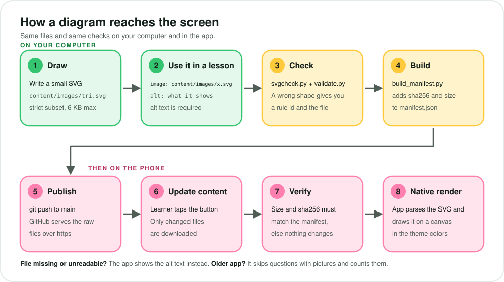

# dopamine-content

[](https://github.com/Kmassidik/dopamine-content/actions/workflows/validate.yml)

The lessons behind [Dopamine](https://github.com/Kmassidik/dopamine), a private, offline Android learning app with no ads, no accounts and no tracking. **241 lessons in 13 courses**, all plain JSON that anyone can read, fix or extend.

**Data only. No code from this repository ever runs in the app.**

<p align="center">
  
  
  
</p>

## What is inside

| Subject | Courses | Lessons |
|---|---|---|
| **Math** | Pre-Algebra (23), Algebra 1 (28), Geometry (28), Algebra 2 (22), Precalculus (22) | 123 |
| **Programming** | C Fundamentals (23), Arrays, Strings and Debugging (21), Algorithms in C (21), Memory and Pointers (22), Data Structures in C (21), Programming Basics in Python (4) | 112 |
| **Science** | Science Basics | 2 |
| **Electronics** | Electronics Basics | 4 |

Every unit has a cheat sheet (`notes.json`) and an app-generated unit quiz. Every lesson is a few short reading pages followed by practice. See [ROADMAP.md](ROADMAP.md) for what is planned next.

## Add your own course

Want to learn something that is not here yet (a language, a tool, an idea like software architecture)? **[AUTHORING.md](AUTHORING.md)** is a step-by-step recipe for making a whole course on any topic, by hand or with an AI agent, including a copy-paste prompt. The result appears in the app after **Settings, Update content**. No app release is needed.

The layout is enforced by tools and CI, so a new course always looks and behaves like the rest. The rules are in **[STANDARD.md](STANDARD.md)**.

## How it reaches the phone

```
 you edit JSON  ->  build_manifest.py  ->  git push main  ->  Settings, Update content
                     (manifest.json:        (raw GitHub)        downloads only what changed,
                      hashes + sizes)                           verifies every file, then swaps
```

The app fetches `manifest.json` from this repo's raw URL on `main`, downloads only the lessons whose version or hash changed, checks size, hash and schema, and swaps them in atomically. If anything fails, nothing changes. A bundled copy of this content also ships inside the app as the first-launch seed.

Pictures take the same road. **[SVG.md](SVG.md)** shows the whole journey of a diagram, from drawing it to the learner's screen:

[](SVG.md)

Removing a course from the manifest hides it in the app after the next update (the files stay on the phone but are never shown).

## Layout

```
catalog.json                                categories, courses, units (hand edited)
<category>/<course>/<unit>/lesson-NN.json   lessons (NN sets the order)
<category>/<course>/<unit>/notes.json       the unit's cheat sheet
images/*.svg                                diagrams referenced by lessons
manifest.json                               GENERATED. Never edit by hand
contract.json                               GENERATED. What the app must understand
schema/                                     JSON Schemas (manifest, lesson)
tools/                                      build_manifest, validate, standard, svgcheck, tests
ROADMAP.md                                  GENERATED coverage and plan
```

## Documents

| File | Read it for |
|---|---|
| [AUTHORING.md](AUTHORING.md) | Make a new course on any topic, step by step, for people and AI agents |
| [SVG.md](SVG.md) | How diagrams work end to end: draw, check, publish, render, with a flow diagram |
| [STANDARD.md](STANDARD.md) | The enforced rules (lesson shape, lengths, SVG subset) and why |
| [ROADMAP.md](ROADMAP.md) | What exists and what is planned |

## Publish an update

1. Add or edit lesson files. **Bump `version` in a lesson whenever you change it.**
2. `python3 tools/build_manifest.py`
3. `pip install jsonschema && python3 tools/validate.py`
4. Commit and push to `main`. In the app: Settings, Update content.

CI (`.github/workflows/validate.yml`) fails when `manifest.json` is stale or any file is invalid. If the bundled seed in the app should include new lessons, also copy `manifest.json`, the lesson folders and `images/` into the app repo's `app/src/main/assets/content/`.

## Add a course, unit or category

Follow [AUTHORING.md](AUTHORING.md). In short: edit `catalog.json` to add the category (`id`, `name`, `icon`, `color` hex, `order`), course (`id`, `categoryId`, `title`, `description`, `order`, `dir`, `overview`) or unit (`id`, `title`, `order`, `dir`), create the folder, add lessons and notes, regenerate the manifest. Icon names the app knows: `ic_math`, `ic_science`, `ic_english`, `ic_swe`, `ic_electronics`; unknown names fall back to a default icon.

## Lesson file

```json
{
  "id": "linear-eq-01",
  "version": 1,
  "title": "One-step equations",
  "xp": 10,
  "tags": ["algebra"],
  "learn": [
    { "id": "what-is-an-equation", "kind": "text", "title": "What is an equation?",
      "body": "An equation says two things are equal, like $x+3=7$." },
    { "id": "example-add", "kind": "example", "title": "Solve $x+3=7$", "body": "Undo the +3.",
      "steps": ["Subtract 3 from both sides: $x=4$", "Check: $4+3=7$."] },
    { "id": "opposite", "kind": "tip", "body": "Do the opposite operation, then check." }
  ],
  "questions": [ { "id": "q1", "type": "multiple_choice", "prompt": "Solve $x+3=7$",
                   "choices": ["$x=4$", "$x=10$", "$x=-4$"], "answerIndex": 0,
                   "explanation": "Subtract 3 from both sides: $x=7-3=4$." } ]
}
```

Rules: ids are lowercase and hyphenated (`^[a-z0-9]+(-[a-z0-9]+)*$`), stable, and never reused for different content. Every question has a unique `id` within the lesson, a `type`, and an `explanation`. Max 40 questions per lesson, lesson file under 256 KB, image under 1 MB. An optional `image` is a relative `.svg` path (no `..`, no leading `/`).

| `type` | Required fields |
|---|---|
| `multiple_choice` | `prompt`, `choices` (2 to 5), `answerIndex` (0-based, into the original order; the app shuffles) |
| `fill_blank` | `prompt` (write the blank as `\\_\\_`), `choices` (2 to 5), `answerIndex` |
| `type_answer` | `prompt`, `accepted` (list of strings), optional `keypad`: `numeric` / `algebra` / `full` |
| `match_pairs` | `pairs`: 2 to 6 `[left, right]` pairs (the app shuffles the right column), optional `prompt` |
| `order_steps` | `steps` in the correct order (the app shuffles), optional `prompt` |

Unknown `type` values are skipped by older apps (forward compatible), so new types can be added carefully.

## Writing math

Text fields support `$inline$` LaTeX (a literal dollar sign is not supported; write the word). The standard only allows commands the app can draw (`LATEX_OK` in `tools/standard.py`). In JSON, backslashes are doubled: `"$\\frac{a}{b}$"`. Keep formulas short; very wide ones can overflow a narrow screen. The renderer has no matrices, `cases` or `align`, and `\left(` `\right)` do not stretch to the height of what they wrap.

Copy style: short, calm, specific. One idea per question. The explanation says why, not just what.
