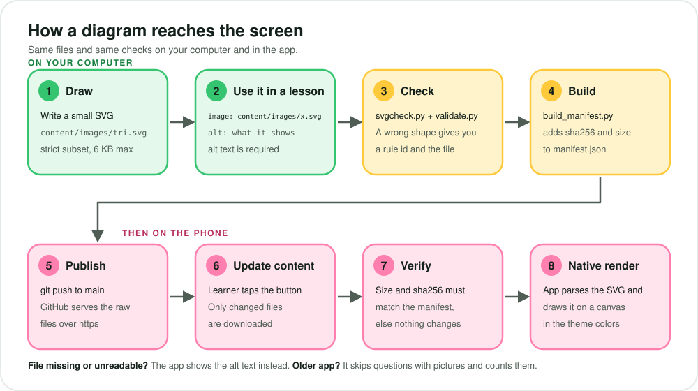

# Diagrams: how SVG works in this repo

A picture can make a hard idea obvious: a right triangle with its sides labelled, a circuit with the current marked, an angle with its pair. Dopamine shows pictures as **SVG**: tiny text files (usually under 1 KB), sharp at any size, and drawn by the app itself with no image library and no WebView.

This page covers the whole journey, from drawing to the learner's screen, and everything you need to add a picture to a lesson.



## The journey in eight steps

| # | Step | Where | What happens |
|---|---|---|---|
| 1 | **Draw** | `content/images/<prefix>-<name>.svg` | You write a small SVG using only the allowed shapes and colors (below). |
| 2 | **Use it in a lesson** | a lesson `.json` file | A learn page or a question gets `"image": "content/images/<file>.svg"` and a required `"alt"` text. |
| 3 | **Check** | `tools/svgcheck.py`, `tools/validate.py` | A strict checker that mirrors the app's renderer rejects anything the app cannot draw, with a rule id and the file name. |
| 4 | **Build** | `tools/build_manifest.py` | The manifest records the picture's path, **sha256** and **size**. |
| 5 | **Publish** | `git push` to `main` | GitHub serves the raw files over https. |
| 6 | **Update content** | Settings in the app | The learner taps the button. Only files whose hash changed are downloaded. |
| 7 | **Verify** | in the app | Size and sha256 must match the manifest. If not, the whole update is discarded and nothing changes. |
| 8 | **Native render** | in the app | The app parses the SVG with its own small parser and draws it on a canvas in the theme's colors. |

Steps 1 to 4 happen on your computer, and CI repeats them on every push. Steps 6 to 8 happen on the phone.

## Draw one in five minutes

Start from [`svg-template.svg`](svg-template.svg), which already passes the checker:

```xml
<svg xmlns="http://www.w3.org/2000/svg" viewBox="0 0 340 200">
  <rect x="20" y="20" width="120" height="70" rx="10" fill="#E4F8EC" stroke="currentColor" stroke-width="2"/>
  <circle cx="240" cy="60" r="35" fill="#FFF3CC" stroke="currentColor" stroke-width="2"/>
  <line x1="140" y1="55" x2="205" y2="55" stroke="currentColor" stroke-width="2" stroke-dasharray="6 4"/>
  <polygon points="40,180 100,120 160,180" fill="#FFE4EE" stroke="currentColor" stroke-width="2"/>
  <path d="M200 180 Q240 120 300 180" fill="none" stroke="currentColor" stroke-width="2"/>
  <g fill="currentColor" font-size="16" font-weight="bold" text-anchor="middle">
    <text x="80" y="60">Screen</text>
    <text x="240" y="65">Data</text>
  </g>
</svg>
```

Habits that make good diagrams:

- **Size.** Use a `viewBox` about 340 wide (the width of a phone card) and as tall as you need. `0 0 340 210` is typical.
- **Coordinates.** `(0,0)` is the top left, `x` grows right, `y` grows **down**. Sketch on paper first and write the numbers on it.
- **Ink in `currentColor`.** Draw lines, outlines and labels in `currentColor`. The app paints it in the theme's ink color, so the diagram stays readable in light and dark mode. Use palette colors only for fills.
- **Always set `fill`.** SVG paints shapes black unless told otherwise. Put `fill="none"` on outlines and lines, or set `fill` on a parent `<g>`.
- **Label with `text`.** Plain characters only. `font-size` between 10 and 48 (14 to 18 reads well on a phone), `text-anchor="middle"` to center a label on its `x`. Keep every label inside the `viewBox`.
- **Keep it simple.** One idea per picture. If you need more than about 30 elements, split it into two pictures or two lesson pages.
- **Right angles and ticks.** Draw a small square with `polyline` (see `content/images/geo-right-triangle.svg`). Equal sides get a short `line` across the middle.

### Cheat sheet: what is allowed

| Part | Allowed |
|---|---|
| Elements | `svg g line rect circle ellipse polyline polygon path text` |
| Attributes | `id x y x1 y1 x2 y2 cx cy r rx ry width height points d fill stroke stroke-width stroke-linecap stroke-linejoin stroke-dasharray opacity font-size font-weight text-anchor` |
| Path commands | `M m L l H h V v C c Q q Z z` (no arcs: draw circles with `<circle>`) |
| Colors | `none`, `currentColor`, or the 16 palette colors below |
| Limits | 6144 bytes, 80 elements, nesting depth 4, `viewBox` sides 20 to 2000 |
| Not allowed | `style`, `class`, `transform`, `href`, `use`, `defs`, gradients, filters, `tspan`, `title`, `desc`, scripts, images, anything with `url(...)` |

Palette: `#FFFFFF #14201A #4F5D55 #E4EAE6` (neutrals), `#35C46F #17803F #E4F8EC #22994F` (green), `#FFC93C #8A5F00 #FFF3CC #D9A21B` (yellow), `#FF7FAE #B8305F #FFE4EE #DB5A8A` (pink). The exact rules are in [STANDARD.md](STANDARD.md#images-svg).

## Put it in a lesson

On a learn page or on a question, add `image` (the path from the repo root, `content/images/<file>.svg`; no `..`, no leading `/`) and `alt`:

```json
{ "id": "theorem", "kind": "text", "title": "The theorem",
  "body": "If the legs are $a$ and $b$ and the hypotenuse is $c$, then $a^2+b^2=c^2$.",
  "image": "content/images/geo-right-triangle.svg",
  "alt": "A right triangle with a short vertical leg labelled a equals 3, a horizontal leg labelled b equals 4, and the slanted side labelled c." }
```

Write the `alt` (10 to 200 characters) for someone who cannot see the picture: say what is drawn and what the labels are. On a **question**, describe the picture **without giving the answer away**. The app uses `alt` for screen readers, and shows it as text if the file is ever missing.

Name files `content/images/<course-prefix>-<name>.svg`, lowercase with hyphens. Several lessons can share one picture.

## Check, build, publish

```bash
python3 tools/svgcheck.py content/images/geo-triangle.svg   # just the picture
python3 tools/build_manifest.py                     # records path, sha256, size
python3 tools/validate.py                           # pictures, lessons, alt text, manifest
git add content manifest.json && git commit -m "Add triangle diagram" && git push
```

Then **Settings, Update content** on the phone. Preview the file by opening it in a browser. One difference: a browser draws `currentColor` as black, while the app uses its theme ink color. When you change a picture, its hash changes, so the app downloads it again. If a phone still shows the old picture, close and reopen the app.

## When something goes wrong

| You see | Rule | Fix |
|---|---|---|
| `attribute 'transform' on <rect> is not allowed` | `IMAGE-ATTR` | Remove it and compute the coordinates yourself. |
| `fill="#123456" is not none, currentColor or a palette colour` | `IMAGE-COLOR` | Use a palette color, `none` or `currentColor`. |
| `<circle> needs an explicit fill` | `IMAGE-FILL` | Add `fill="..."` on the shape or a parent `<g>`. |
| `path command 'A' is not allowed` | `IMAGE-PATH` | Use `<circle>`/`<ellipse>`, or approximate the curve with `Q` or `C`. |
| `the root <svg> needs viewBox="0 0 W H"` | `IMAGE-VIEWBOX` | Add a `viewBox`, for example `0 0 340 210`. |
| `<style> is not allowed` | `IMAGE-ELEMENT` | Put `fill` and `stroke` directly on each shape. |
| size, element or depth limit | `IMAGE-SIZE` | Simplify: fewer shapes, shorter numbers, under 6 KB. |
| picture has no `alt` | `IMAGE-ALT` | Add 10 to 200 characters describing it. |

## What the learner's app does with it

- **Good file:** it is parsed once, cached, and drawn crisply at the card's width. It is announced to a screen reader with the `alt` text.
- **File missing or unreadable:** the card shows the `alt` text instead, so nothing is lost.
- **Older app without the renderer:** it skips questions that have an image and counts them, so nothing is hidden silently.
- **Tampered or truncated download:** the size and sha256 check fails and the whole update is discarded.

## Ask an AI agent to draw one

```text
Draw a diagram for the Dopamine app: <WHAT IT SHOULD SHOW>, for the lesson "<LESSON TITLE>".

Read docs/SVG.md and docs/STANDARD.md (section "Images (SVG)"). Start from docs/svg-template.svg.
Rules: viewBox about 340 wide, only the allowed elements, attributes and palette colors,
ink in currentColor, explicit fill on every shape, labels inside the viewBox, under 6 KB.
Save it as content/images/<prefix>-<name>.svg, add "image" and a good "alt" to the lesson, then run
tools/svgcheck.py, tools/build_manifest.py and tools/validate.py until they pass.
Check every number and label in the drawing is correct before you finish.
```
